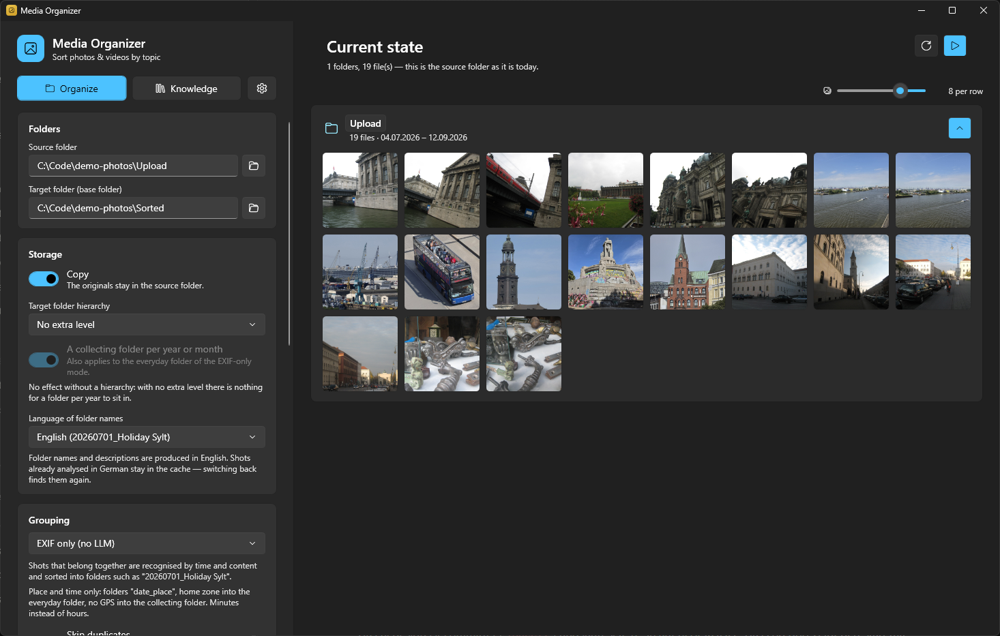
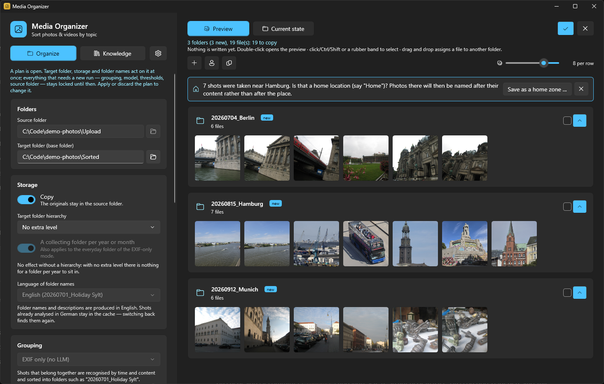
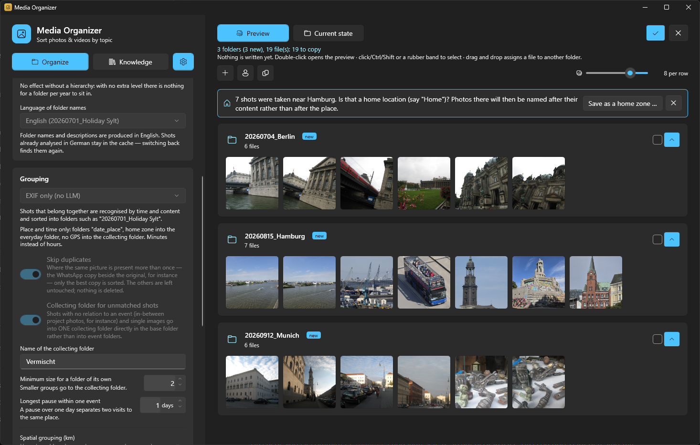

# Media Organizer

Windows desktop application that sorts photos and videos from a source folder
into thematic event folders named `YYYYMMDD_<topic>` (for example
`20260701_Urlaub Sylt`). Content recognition runs entirely locally through
**Gemma 4** via [Ollama](https://ollama.com) and/or through EXIF and container
metadata. **Nothing leaves the machine** — there is no cloud service, no
telemetry and no account.

Version 1.0.0 · Windows 11 · portable

---

## Screenshots



*Organize: the source folder as it is today, and the storage settings.*



*The preview. Nothing is written until you apply it. Here in EXIF-only mode: three
folders named by date and place.*



*The grouping and filing settings. The demo photos are CC0, see the
[credits](docs/screenshots/CREDITS.md).*

---

## Table of contents

- [Install](#install)
- [What it needs](#what-it-needs)
- [Updates](#updates)
- [First run](#first-run)
- [How it works](#how-it-works)
  - [The pipeline](#the-pipeline)
  - [Grouping modes](#grouping-modes)
  - [Naming](#naming)
  - [Home zones and everyday places](#home-zones-and-everyday-places)
  - [Face recognition](#face-recognition)
  - [Knowledge base and image notes](#knowledge-base-and-image-notes)
  - [The collecting folder](#the-collecting-folder)
  - [Never overwriting anything](#never-overwriting-anything)
- [Settings](#settings)
- [Performance: where the time goes](#performance-where-the-time-goes)
- [Where your data lives](#where-your-data-lives)
- [Diagnosing a bad result](#diagnosing-a-bad-result)
- [Building from source](#building-from-source)
- [Making a release](#making-a-release)
- [Project layout](#project-layout)
- [Third-party components](#third-party-components)
- [Known limits](#known-limits)

---

## Install

Media Organizer ships **portable**. There is no installer and nothing is
registered with Windows.

1. Download `MediaOrganizer-1.0.0-win-x64.zip` from the
   [releases page](https://github.com/smohring/media-organizer/releases).
2. Unpack it into a folder you can write to — for example
   `C:\Tools\MediaOrganizer` or a folder in your user profile.
   **Not** into `C:\Program Files`: the application replaces its own files when
   it updates, and it cannot do that without administrator rights.
   **Not** onto the root of a drive either; the updater refuses to run there,
   for the same reason it refuses to delete a drive.
3. Start `MediaOrganizer.exe`.

The .NET 10 runtime is inside the package. Nothing else has to be installed for
the application to start.

Settings, the knowledge base and the analysis cache live in
`%AppData%\MediaOrganizer\`, not in the program folder — an update replaces the
program folder wholesale and would take them with it.

### About the SmartScreen warning

Release 1.0.0 is not signed with a code signing certificate, so Windows shows
"Windows protected your PC" on first start. Choose *More info* → *Run anyway*.
The build pipeline is prepared for signing (see
[Making a release](#making-a-release)); this note disappears with the first
signed release.

---

## What it needs

| | Needed for | Without it |
|---|---|---|
| **Windows 11 x64** | everything | Windows 10 works but the Fluent theme falls back |
| **[Ollama](https://ollama.com)** with a Gemma 4 model, 12B or larger | every content-based mode | only the EXIF mode works |
| **ffmpeg** | video frame analysis, video thumbnails | videos are sorted by their container metadata only |
| **Face recognition models** (39 MB) | recognising people | the option stays off |

None of these is bundled, and none has to be dealt with before the first start.
The application checks all three itself and offers to fetch what is missing:

- **Ollama** — the settings panel shows a status light and can download the
  model directly (`ollama pull`). Ollama itself has to be installed once, from
  [ollama.com](https://ollama.com).
- **ffmpeg** — one click installs it through **winget** (`Gyan.FFmpeg`). The
  search covers the process, user and machine `PATH` as well as the winget
  package folders, so a fresh installation is found without restarting the
  application.
- **Face models** — one click downloads YuNet and SFace from the OpenCV Zoo
  into `%AppData%\MediaOrganizer\models`.

### Which model

Gemma 4 from **12B upwards**. Smaller variants are deliberately not offered.
Measured on the same photo of a toddler with chocolate around their mouth:

| Model | Description | Time |
|---|---|---|
| E4B | "A pair of feet standing on a light floor" | 8.4 s |
| 12B | "A toddler with blonde hair … has chocolate around their mouth" | 4.9 s |

With descriptions like the first one no thematic grouping is possible, and the
small model was not even faster.

Two are offered: **Gemma 4 12B** and **Gemma 4 26B**, the latter as Unsloth's
quantisation-aware build
(`hf.co/unsloth/gemma-4-26B-A4B-it-qat-GGUF:UD-Q4_K_XL`). The 12B needs roughly
10 GB of VRAM, the 26B roughly 16 GB — that build exists for exactly this
reason: Ollama's own 26B is 19 GB and no longer fits a 16 GB card. A model that
does not fit falls back to the CPU and gets dramatically slower — worth checking
before blaming the application.

---

## Updates

The application checks an HTTPS feed once a day for a newer release and says so
in the settings panel. It never downloads or installs anything on its own, and
it never interrupts a run to announce a patch release — an organizing run can
take hours.

When you choose to update, it downloads the release archive, verifies it,
unpacks it, closes itself, replaces its own folder and starts again. A run in
progress is lost, so it asks first.

**What guards the download**, in this order:

1. The feed is fetched over TLS, so the checksum it carries comes from the
   release owner and not from whoever controls the network.
2. The archive's SHA-256 must match that checksum before anything is unpacked.
3. If `UpdateExpectedSigner` is configured in `settings.json`, the unpacked
   executable must additionally carry a valid Authenticode signature from that
   subject, verified through Windows' own trust provider.

The third guard is off by default and stays off until releases are signed for
real — a build signed with a self-created test certificate cannot pass it, and a
guard you have to switch off to get any work done is one you switch off for
good.

You can point the application at a different feed, or switch the check off
entirely, in `%AppData%\MediaOrganizer\settings.json`
(`UpdateFeedUrl`, `CheckForUpdatesOnStart`). Anything that is not `https` is
refused.

---

## First run

1. Pick a **source folder** and a **target folder**. The target may sit inside
   the source; it is skipped during the scan.
2. Leave **Move** on, or switch to **Copy** if you want the originals to stay
   put. Copy is the safer way to try the application out.
3. Press **Start**. Nothing is written yet — the run produces a *plan*.
4. Go through the result view, correct what is wrong (drag and drop, rename
   folders, move shots), then apply it.

The plan is the point. Every run stops there, and no file is touched until you
say so. If you do apply a plan and regret it, **Undo last run** puts everything
back where it came from.

---

## How it works

### The pipeline

`OrganizePipeline.PlanAsync` runs these steps in order:

```
scan → metadata → notes & faces → grouping → region merge →
minimum size → naming → plan
```

The plan writes nothing. Only `PlanExecutor.ExecuteAsync` touches files, and it
journals every move so the run can be undone.

**Scan** walks the source folder recursively and skips hidden and system files
as well as the target folder.

**Metadata** reads EXIF `DateTimeOriginal`, GPS and camera model for images;
for videos the creation date from the MP4/QuickTime atoms (`mvhd`, UTC
converted to local time; values before 1980 are the unset 1904 epoch and are
discarded), duration, and GPS from ISO 6709 strings (`©xyz`). When nothing
usable is there it falls back to the oldest file system timestamp and reports
that as a warning — a file system timestamp says when the file was copied, not
when the photo was taken, and hundreds of copied files share one.

### Grouping modes

| Mode | Who draws the boundaries | Cost |
|---|---|---|
| **EXIF only** | time and GPS alone | minutes |
| **LLM automatic** | the model, on content | hours |
| **Combined** (default) | EXIF proposes, the model refines both ways | hours |

Time is deliberately only a coarse safety boundary; the real separation comes
from content. An earlier "maximum time gap" setting was removed for that reason.

- **LLM automatic / Combined**: candidate windows are split at gaps over
  **48 h**. Inside a window time is a soft factor — a morning outing and dinner
  stay together — and content decides. Windows over 60 items are segmented at
  day boundaries to fit the context limit.
- **EXIF only**: hard split at gaps over **30 h**. Within that, a gap over
  **8 h** splits only when GPS does *not* show that things continue in the same
  place (under 25 km). So with a GPS-carrying camera a multi-day holiday stays
  together; without GPS you get one group per day, because without a content
  signal "holiday day 2" is indistinguishable from a new event.

The **combined** mode refines the EXIF base groups in both directions:

- **Splitting**: each base group is partitioned by content through one model
  call over its timeline. This matters for time-dense but thematically mixed
  material — files without EXIF that all carry the same copy timestamp, for
  instance.
- **Merging**: neighbouring groups are checked for belonging together, so
  holiday days separated by a day split find each other again. Merging never
  touches what the split just separated, and never joins a home group with a
  clearly away one.

### Naming

Within a final group, subgroups are formed from the model's `category` per item
(falling back to chronological subclusters with gaps over 2 h). The
chronologically **first** photo of each subgroup — at most three images — goes
into the naming call, together with the time span, the GPS centre and the list
of visited places.

**Offline place resolution.** An embedded place database (GeoNames
**cities1000** worldwide plus all German localities, CC-BY 4.0) resolves GPS
coordinates to the nearest place without any network access. Lookup runs over a
1° grid (about 1 ms, with a one-off 150 ms load); among nearly equally close
candidates the most populated one wins, so "Köln" beats a suburb entry.

For trips the geometric centroid is never geocoded — on a round trip that lands
in the middle of nowhere. The largest stay clusters are used instead, and the
naming prompt receives the list of places visited.

### Home zones and everyday places

Whether a place says anything about belonging together is decided by
`Geo.PlaceIndex`: several separate visits mean an **everyday place** (home), a
single visit means a **trip**. This is derived from the data, not configured.
Before that it hung on a hand-placed zone, and if the zone was two kilometres
off, the living room counted as an outing.

On top of that you can name **zones** — GPS points with a radius — and each
zone has a kind:

| Kind | Meaning |
|---|---|
| `Home` | everyday life. Different activities here stay separate events, and the place name does not go into the folder name. |
| `Vacation` | a recurring holiday place (holiday flat, campsite). Counts as being away. |
| `Place` | another named place the model should know (nursery, sports club). Also counts as being away. |

Without the kind, every zone counted as home — and a zone called "holiday"
suppressed exactly the outing logic it was created for.

Zones are created from a one-click suggestion after a run (the most frequent
location), through the house icon on a result group, or by hand.

### Face recognition

Optional, off by default, entirely local. Two ONNX models from the OpenCV Zoo
(Apache-2.0), downloaded on demand:

- **YuNet** (227 KB) finds faces and five landmarks (eyes, nose, mouth
  corners).
- **SFace** (37 MB) turns each into a 128-value vector, about 500 bytes per
  face — the compact, comparable representation of a face.

Between the two steps the crop is brought onto the ArcFace standard pose
(112×112) by a similarity transform. That alignment step is decisive: without
it the vectors are useless. Comparing two faces afterwards is a dot product —
microseconds, no matter how many people are known.

**Why not the model?** Gemma is trained on *semantic* understanding ("a blonde
toddler"), not on telling identities apart. Comparing images through the model
costs seconds per pair and gets similar faces wrong regularly. The specialised
models solve exactly this one task, which is how 37 MB beats 12 GB.

**Measured on real photos**: 47 ms per image, about 2 % on top of the model
analysis. With a *single* reference face each, one child was correctly
recognised on 62 further faces and one adult on 10; similarity between
different people sat around 0.0, between shots of the same person at 0.55–0.88.
The recognition threshold is 0.40, measured rather than guessed.

**Guards against a wrong match**: a name is only used when the similarity is
over the threshold **and** the best candidate is clearly better than the second
best (a margin of at least 0.05). With two similar-looking people the match is
deliberately left open and logged.

**Positions go into the prompt.** Recognised names are passed with their place
in the frame ("Mia on the left of the image, Jonas on the right") — and so
are the positions of faces that were *not* matched. Both are necessary. Without
positions the model spreads known names over the wrong faces; without the
position of the unknown ones it describes the wrong person. In one test an
adult woman was described as "a small child" because the model did not know
which of the three was the unknown one.

**Teaching it people — two ways.** Before a run (recommended): *Knowledge* →
*Learn from folder*. The application scans the source folder, clusters all
faces it finds by similarity and shows up to four deliberately different
reference faces per cluster; you name each person once. Measured on a real
source folder: 255 images in 13 s, yielding 12 recurring people.

The clustering threshold (0.45) sits deliberately above the recognition
threshold: better two clusters of the same person, which are easy to merge,
than two people in one cluster, which would corrupt the reference vectors for
good.

After a run: right-click a photo → *Assign people*. Then **Recognise people and
rename** updates the folder names — it recognises people on the already sorted
files and renames the affected folders **without moving files and without
re-analysing images**. That solves the chicken-and-egg problem: assigning
people after the sorting run does not mean redoing it.

### Knowledge base and image notes

Right-click an image → **Pin note** ("my daughter Mia playing"). Notes are
stored by content hash, so they survive moving and renaming, and they work in
three ways:

1. Directly in that image's analysis prompt — and in its cache key, so a
   changed note forces a fresh analysis.
2. One distillation call per run extracts lasting **facts** from new notes
   ("Mia is the user's daughter").
3. Facts go into every description and naming prompt from then on, so the model
   names known people instead of paraphrasing them.

The instruction to use names is deliberately directive; a softer wording left
the model at "A toddler …". It is balanced by a strict counter-rule: no
person's name on an image without people, and a fact is never transferred to
something that merely resembles it in material or shape.

The honest limit: this is heuristic association, not identification. Face
recognition is the part that identifies.

**Writing descriptions into the file** (option, off by default): the generated
description is written into the JPEG as XMP `dc:description` — one field, and
the one photo software reads. Explorer shows it under Properties ▸ Details as
"Title". Earlier versions wrote the EXIF fields `ImageDescription` and
`XPComment` on top of it, which filled three rows of that dialog with the same
sentence; those two are removed again from every file that is described anew.
The insert happens losslessly at JPEG segment level: the compressed image data
stays **byte-identical**, existing EXIF (date, GPS) and XMP are preserved, and
the write goes through a temporary file with backup replacement so an
interruption never damages the original.

### The collecting folder

Option "collecting folder for unmatched shots" (LLM modes, on by default). The
grouping prompt may mark shots with no event relation — in-between project
photos, screenshots, single snapshots — as unmatched. Together with
single-image groups they land in **one** collecting folder, without a date
prefix, directly in the base folder. Every run fills the same one.

The collecting folder is for in-between shots, **not** for everything the model
fails to place thematically. Before a shot goes there it is checked
deterministically: if its category matches an existing group (at least a third
of that group shares the category), it goes there instead. And when travelling,
`FindPlaceGroup` pulls such shots back into the event.

Media with no analysis at all — a video with no ffmpeg, an image with no codec
— **never** go to the collecting folder. They follow the nearest group in time
and space instead.

### Never overwriting anything

| Situation | What happens |
|---|---|
| Same name, **same content** (size + SHA-256) | skipped as a duplicate; in move mode the source file stays put, and the result view says so |
| Same name, **different content** | unique name: `IMG_1234 (2).jpg` |
| Same folder name (date and topic both repeat) | suffix: `Topic 2` |

Every correction in the result view goes through the same collision-safe
transfer routine as the main run.

---

## Settings

| Setting | Default | What it does |
|---|---|---|
| Transfer mode | Move | Copy leaves the originals in place |
| Target hierarchy | Flat | optionally `2026\` or `2026\07\` above the event folders |
| **Language of folder names** | German | the language the model answers in — see below |
| Grouping mode | Combined | see [Grouping modes](#grouping-modes) |
| Model | `gemma4:12b` | one model for analysis, grouping and naming |
| Collecting folder | on | plus its name, default `Vermischt` |
| Minimum group size | 2 | smaller groups go to the collecting folder; 1 disables the check |
| Same place within | 2.0 km | GPS counter-check against the model's decision; 0 disables it |
| Whole groups: same place within | 10.0 km | merges neighbouring groups of one trip; never applies at home; 0 disables it |
| Recognise people automatically | off | see [Face recognition](#face-recognition) |
| Write description into the file | off | modifies your original files |
| Analysis cache | on | see [Performance](#performance-where-the-time-goes) |
| **Concurrent analyses** | 4 | the biggest speed lever; 1 restores strictly serial behaviour |
| **Reuse burst descriptions** | on | analyse a burst once instead of six times |
| Check for updates at start | on | see [Updates](#updates) |

### Language of folder names

The interface is English; your collection probably is not. This setting decides
what language the model answers in, and therefore what the folders are called —
`20260701_Urlaub Sylt` or `20260701_Holiday Sylt`.

**Switching costs nothing.** The language is part of the analysis cache key,
but only for English: German entries keep exactly the key they have always had.
Descriptions in both languages sit in the cache side by side, so trying English
and switching back finds your existing descriptions still there. Without that,
trying it out would cost about ten hours of re-analysis on ten thousand photos.

### Concurrent analyses

Measured on 80 real photos with `gemma4:26b`, cache off:

| | serial | 4 concurrent |
|---|---|---|
| whole run | 2.5 min | 2.2 min |
| of which analysis | 1594 ms/image | 1309 ms/image |

These are exactly the same calls; the results do not change. Values that are
too high cost VRAM for each concurrent request's context and can push an
already tight model onto the CPU.

### Reuse burst descriptions

Shots from the same camera taken within seconds at the same place get the
description of the first one. In a real run six shots over 15 seconds cost six
vision calls and produced the same sentence six times. Measured on 80 photos:
24 of 80 taken from bursts, analysis down from 1309 ms to 921 ms per image,
same grouping.

It stays a bet that a burst shows the same thing, so it is narrowly guarded:
same camera, a few seconds apart, same place, same recognised people, a real
EXIF timestamp, and no note on the image. Any uncertainty ends the burst rather
than extending it. An earlier and much broader inheritance between "similar"
images was removed because it spread wrong descriptions on real photos.

---

## Performance: where the time goes

Measured on an RTX 5080 with `gemma4:26b`, extrapolated to 10 000 shots:

| Phase | per unit | 10 000 files |
|---|---|---|
| **Image analysis (LLM)** | **3.66 s/image** | **≈ 10 h — about 93 %** |
| Thematic grouping | 4.1 s per block of 40 | ≈ 17 min |
| Naming | 2.3 s/group | ≈ 20 min |
| Face recognition | 47 ms/image | ≈ 8 min |
| Metadata, hashes, plan | < 10 ms/file | ≈ 2 min |

So **optimisations outside the analysis phase almost never pay off.** Within one
analysis call, 0.83 s goes on the prompt, 0.59 s on the response and **2.24 s on
encoding the image** — which is why shorter prompts (3 %) and smaller images
(9 %, with worse descriptions) are dead ends.

The levers that do work are concurrency and burst reuse, both above, plus:

- **Thinking is disabled** (`think=false`, hard-wired). Gemma 4 produces long
  invisible reasoning tokens by default — measured at ~5.3 s instead of ~0.7 s
  per image on the 12B model — and with a tight `num_predict` the thinking
  crowds out the actual answer. For structured JSON tasks it buys nothing.
- **The analysis cache** stores descriptions by content hash, so repeat and
  follow-up runs skip files already analysed. The key covers file length, the
  first and last 64 KB, the model tag, the prompt version, the output language,
  the knowledge facts and the recognised people — everything that changes the
  prompt. It is capped at 6000 entries with least-recently-used pruning.
- **The face cache** stores the feature vectors, not the finished assignment to
  people. That distinction is the whole point: the expensive part is finding and
  measuring faces, and storing the assignment would make the cache worthless the
  moment a new person is added — exactly when it is needed.

**Still open:** Ollama itself delivers a factor of 2.2 from concurrency with the
same images (3.68 s → 1.64 s per image); the application only gets 1.22 of that.
Image preparation is not the cause (29 ms per image, scaling by 3.2). Anyone
picking this up starts with the question why a call from inside the application
takes only 1.59 s serially while the same call from outside takes 3.68 s.

---

## Where your data lives

Everything under `%AppData%\MediaOrganizer\`:

| File | Contents |
|---|---|
| `settings.json` | settings, including zones |
| `knowledge.json` | facts and image notes, keyed by content hash |
| `notes/` | thumbnails for the notes |
| `analysis-cache.json` | model descriptions per file hash and model |
| `face-cache.json` | face feature vectors per file hash |
| `models/` | the two ONNX face recognition models |
| `logs/lastrun.log` | log of the most recent run |

Deleting the folder resets the application completely. It never touches your
photos.

To use a different folder, set the environment variable `MEDIAORGANIZER_DATA` to
it. That is handy for trying the application without touching your real settings
and caches.

---

## Diagnosing a bad result

Every run writes a full log to `%AppData%\MediaOrganizer\logs\lastrun.log`:
settings and model, GPS coverage, effective home zones, **every** image
description (fresh or from the cache), the complete grouping timelines
including the model's raw answer, merge decisions, home/away splits, and a
per-phase timing summary at the end.

When something lands in the wrong folder, **look there first**. On this project
guesses have been wrong repeatedly and the log had the answer every time.

The header line names the mode, model, output language, minimum size, GPS
radius, region radius and the number of home zones. If the result does not match
the settings, the fault is in the settings and not in the model.

The timing summary at the end should show analysis taking the lion's share
(roughly 80–93 %). If it does not, something else is wrong — hundreds of tiny
groups each costing a naming call, for instance.

Failed model calls are retried once and then reported as a visible warning in
the result view. They are never silently swallowed into a fallback.

---

## Building from source

```bash
dotnet build MediaOrganizer.slnx
dotnet run --project src/MediaOrganizer.App
```

Needs the .NET 10 SDK. A development build is framework-dependent and fast; the
self-contained settings live in a publish profile so they do not slow down every
build.

Tests:

```bash
dotnet test tests/MediaOrganizer.Tests/MediaOrganizer.Tests.csproj
```

The tests reach the grouping rules directly through `InternalsVisibleTo` rather
than by reflection, so a rename breaks at compile time instead of at runtime.

**A running instance locks `MediaOrganizer.Core.dll`** — close the application
before building, or the build fails with a file-in-use error.

---

## Making a release

```powershell
.\build\release.ps1 -Notes "What changed in this release."
```

This publishes self-contained, signs the binaries if a certificate is
configured, packs the archive, computes its SHA-256 and writes `latest.json`.
The version comes from `VersionPrefix` in `Directory.Build.props` — the single
place a release number is written down — and is read back out of the compiled
executable so the archive and the feed can never disagree with what was built.

Afterwards, by hand:

1. Create the GitHub release for tag `v<version>` and attach the archive.
2. Copy the generated `latest.json` over `release/latest.json` and push it.
   Running clients read that file; until it is pushed, nobody is offered the
   update.

### Signing

Nothing about the certificate is in this repository. `build\sign.ps1` reads it
from the environment:

```powershell
$env:MEDIAORGANIZER_CERT_PATH = 'C:\path\to\certificate.pfx'
$env:MEDIAORGANIZER_CERT_PASSWORD = '...'
# or, for a hardware token or a certificate already in the store:
$env:MEDIAORGANIZER_CERT_THUMBPRINT = '...'
```

A timestamp is always requested. Without one, every signature stops validating
the day the certificate expires — including on releases that shipped years
earlier.

`signtool.exe` is found on `PATH`, in the Windows SDK, or in the NuGet package
cache. The cheapest way to get it needs no installation and no elevation:

```bash
dotnet restore build/signtool/signtool.csproj
```

Without a certificate the release still builds; the binaries are simply left
unsigned and the script says so. Pass `-RequireSignature` to turn that into an
error for a real release.

`build\new-test-certificate.ps1` creates a self-signed certificate for testing
the pipeline. It proves the mechanics work — it does not produce trust, and a
build signed with it must not be shipped.

---

## Project layout

| Project | Contents |
|---|---|
| `src/MediaOrganizer.Core` | UI-free logic: scan, metadata, grouping, naming, planning, execution, knowledge base, updates. Knows nothing about WPF. |
| `src/MediaOrganizer.App` | Interface and everything that needs Windows imaging codecs. |
| `tests/MediaOrganizer.Tests` | xUnit. |

The two are coupled through `IImagePreprocessor`: the core asks for scaled-down
JPEGs for analysis, the application delivers them through WPF imaging. That
keeps the core UI-free while still using the Windows codec pipeline, including
HEIC where the codec is installed.

Who decides what:

| Question | File |
|---|---|
| Which files are read, in what order everything runs | `OrganizePipeline` |
| Time-based base groups from EXIF/GPS | `Grouping/ExifGroupingStrategy` |
| Content-based splitting by the model | `Grouping/LlmGroupingStrategy` |
| Splitting and re-merging combined | `Grouping/CombinedGroupingStrategy` |
| Burst detection | `Grouping/BurstDetector` |
| Everyday place or trip | `Geo/PlaceIndex` |
| Folder name | `Naming/GroupNamingService`, `Naming/GroupContextClassifier` |
| Every prompt | `Llm/Prompts`, `Llm/GermanPrompts`, `Llm/EnglishPrompts` |
| Image description and its cache | `Llm/MediaDescriber`, `Llm/DescriptionCache` |
| Facts and notes | `Knowledge/KnowledgeStore`, `Llm/KnowledgeDistiller` |
| Target paths and conflicts | `Planning/PlanBuilder`, `Planning/PlanPaths`, `Planning/PlanConflicts` |
| Touching files, undoing a run | `Planning/PlanExecutor`, `FileOps/RunJournal` |
| Checking for and applying updates | `Update/UpdateService` |
| Interface | `App/MainWindow.xaml`, `App/Views/KnowledgeView.xaml` |

---

## Third-party components

| Component | Licence | Used for |
|---|---|---|
| [.NET 10](https://dotnet.microsoft.com) | MIT | runtime, shipped inside the package |
| [CommunityToolkit.Mvvm](https://github.com/CommunityToolkit/dotnet) | MIT | MVVM in the interface |
| [NAudio](https://github.com/naudio/NAudio) | MIT | sound for the built-in video player |
| [MetadataExtractor](https://github.com/drewnoakes/metadata-extractor-dotnet) | Apache-2.0 | EXIF and container metadata |
| [OpenCvSharp](https://github.com/shimat/opencvsharp) | Apache-2.0 | face detection and recognition |
| [YuNet, SFace](https://github.com/opencv/opencv_zoo) (OpenCV Zoo) | Apache-2.0 | the two face models, downloaded on demand |
| MobileNetV2 (OpenCV Zoo) | Apache-2.0 | scene similarity vectors, downloaded on demand |
| [GeoNames](https://www.geonames.org) cities1000 | CC-BY 4.0 | offline place resolution, embedded |
| [Ollama](https://ollama.com) | MIT | local model host, installed separately |
| [ffmpeg](https://ffmpeg.org) | LGPL/GPL | video frames, installed separately |

---

## Known limits

- **HEIC and RAW** need the matching Windows codec extensions for preview and
  analysis. Without the codec the file is still sorted correctly by EXIF — just
  without a thumbnail and without content analysis.
- **Cancelling during the transfer** leaves already transferred files in the
  target. There is no rollback, deliberately, because no data is ever lost; the
  application points this out, and *Undo last run* handles the rest.
- **Updating requires a writable program folder.** Unpacked into
  `C:\Program Files`, the application will find updates but cannot apply them,
  and it says so before downloading anything.
- **Release 1.0.0 is unsigned**, so SmartScreen warns on first start.
- The custom toggle switch stands in for the control still missing from the WPF
  Fluent theme.

---

## Licence

Media Organizer is released under the [MIT licence](LICENSE). The components
above keep their own licences.
